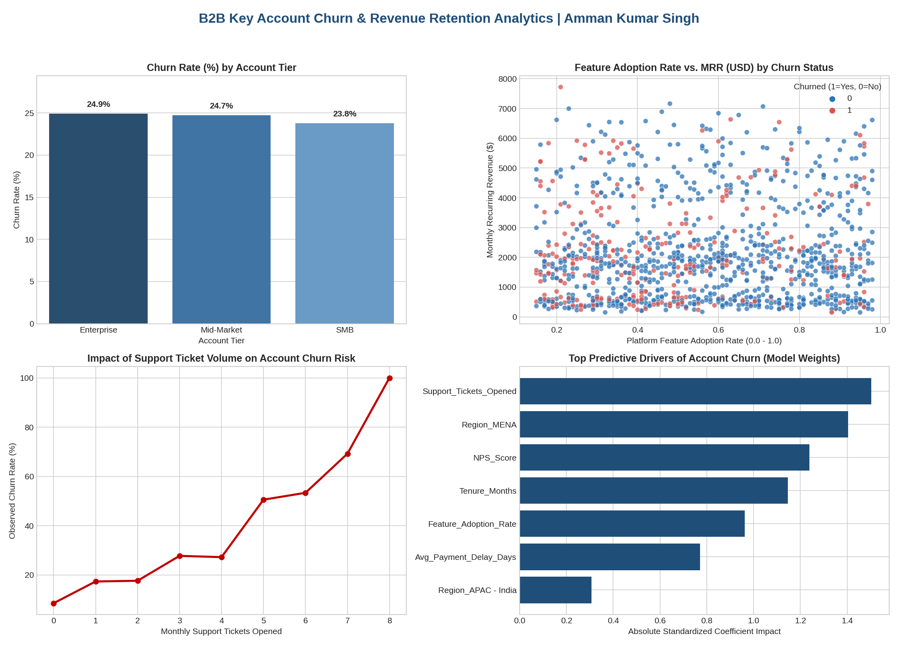

# 📊 Predictive Modeling for B2B Customer Churn & Account Retention

**Author:** Amman Kumar Singh  
**LinkedIn:** [linkedin.com/in/amman-s-3a9301242](https://www.linkedin.com/in/amman-s-3a9301242)  
**Tech Stack:** Python (`Pandas`, `Scikit-Learn`, `NumPy`, `Matplotlib`, `Seaborn`), SQL, Machine Learning (Logistic Regression, SVM)

---

## 📌 Executive Summary
Customer retention is a primary growth lever in B2B SaaS and enterprise account management. This project designs and implements an end-to-end **Machine Learning classification pipeline** to predict customer churn risk across **1,200 B2B accounts** spanning APAC and MENA regions (observing a baseline churn rate of **24.5%**).

By combining behavioral product telemetry (`Feature_Adoption_Rate`, `Monthly_Active_Logins`), support health (`Support_Tickets_Opened`, `NPS_Score`), and commercial metrics (`Monthly_Recurring_Revenue_USD`, `Avg_Payment_Delay_Days`), the model identifies at-risk accounts ahead of renewal cycles and provides actionable retention playbooks for Key Account Managers.

---

## 🎯 Key Results & Model Performance
* **Logistic Regression Model:** Achieved **88.3% accuracy** and **0.950 ROC-AUC**, offering clear interpretability of key churn drivers.
* **Support Vector Machine (SVM - RBF Kernel):** Achieved **85.3% accuracy** and **0.925 ROC-AUC** in classifying non-linear account risk patterns.
* **Primary Churn Drivers Identified:**
  1. **Low Feature Adoption (<45%):** Strongest leading indicator of account attrition.
  2. **Support Ticket Spikes (4+ tickets/month):** Signals unresolved technical friction and correlates with a sharp rise in churn probability.
  3. **Low Tenure & NPS Scores:** Early-stage accounts with low satisfaction scores require immediate onboarding intervention.

---

## 📈 Visual Analytics Dashboard

---

## 📂 Repository Structure
* `Customer_Churn_Predictive_Modeling.ipynb` — Complete Jupyter Notebook containing Exploratory Data Analysis (EDA), feature engineering, model training (Logistic Regression & SVM), and evaluation metrics.
* `b2b_account_churn_data.csv` — Structured dataset of 1,200 B2B accounts with revenue, engagement, and churn labels.
* `churn_analytics_dashboard.png` — High-resolution executive visualization summarizing key findings.
* `README.md` — Project documentation and strategic recommendations.

---

## 💡 Strategic Recommendations for Key Account Management
1. **Automated Health-Score Alerts:** Integrate model probability scores into CRM (Salesforce/HubSpot) to flag accounts crossing a 60% churn probability threshold 90 days before contract renewal.
2. **Guided Product Adoption:** Launch targeted onboarding workshops for Mid-Market and Enterprise accounts with feature adoption below 50%.
3. **Executive Escalation Path:** Automatically route accounts opening 4+ monthly support tickets to dedicated technical account managers.
